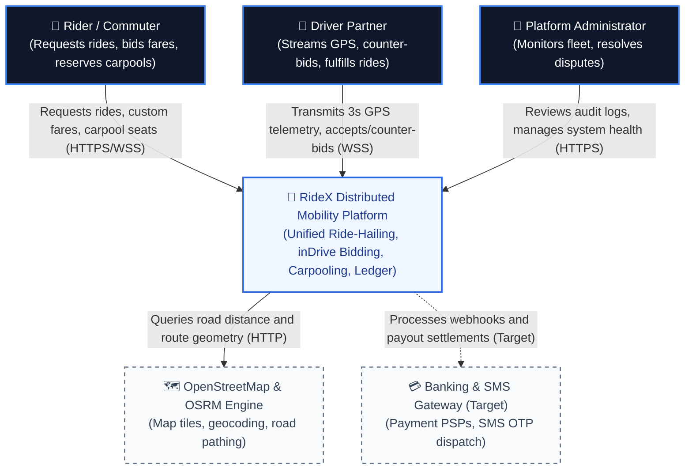
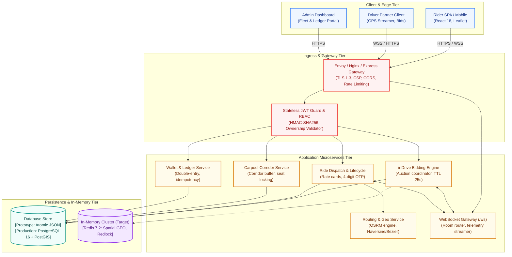
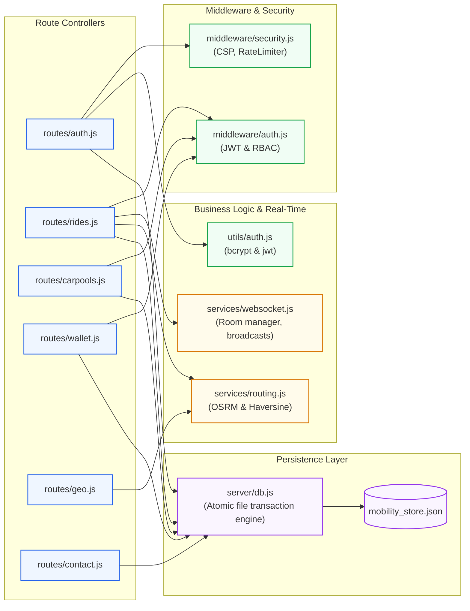
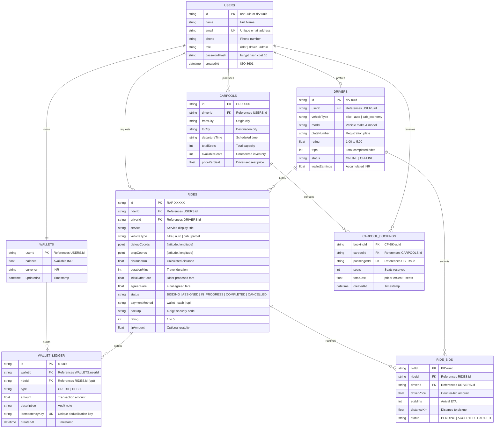
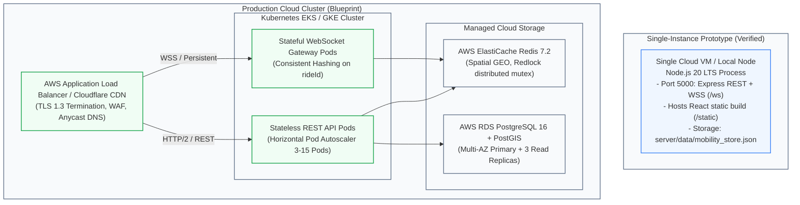
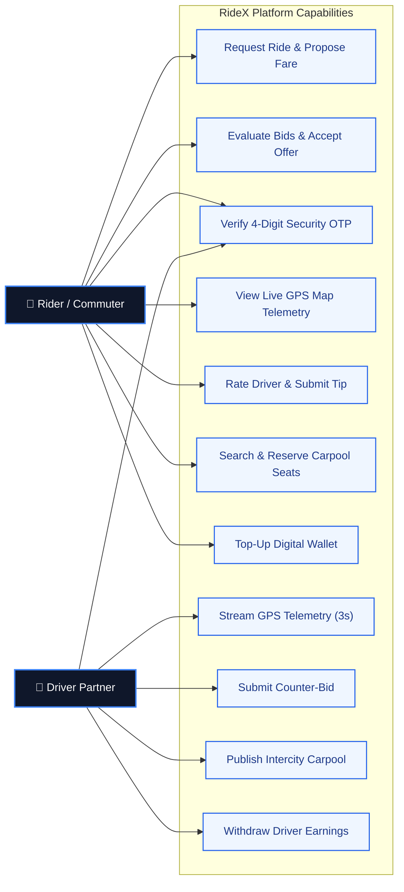
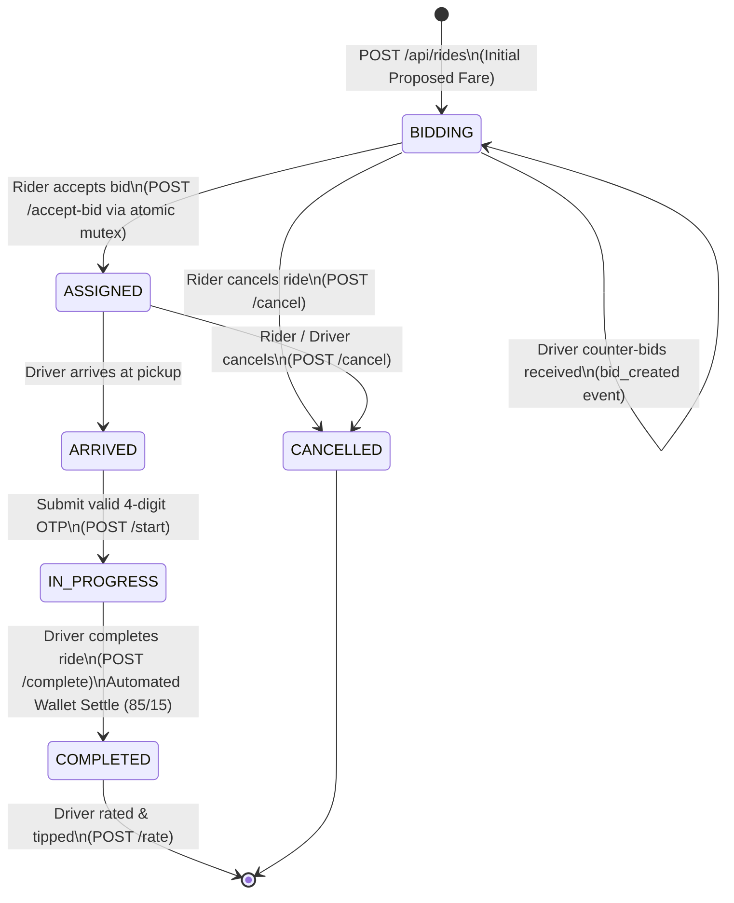
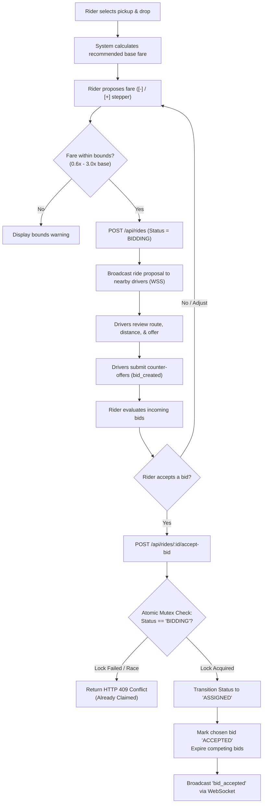
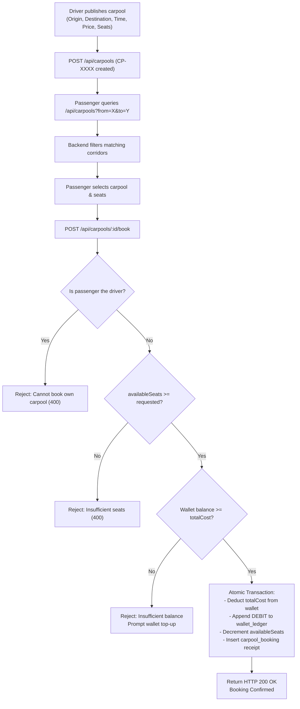

# RideX Architecture Diagrams Catalog (Editable Formats)

This document contains editable, production-grade architecture and UML diagrams for **RideX — A Smart Ride-Hailing and Intercity Carpooling Platform**.

Diagrams are provided in standard **Mermaid.js** format (supported directly in Markdown renderers, GitHub, and VS Code) and **PlantUML** format. For visual diagramming, refer to the editable XML file `RideX_Architecture_Design.drawio` included in the root directory.

---

## 1. System Context Diagram (C4 Level 1)

### Mermaid


---

## 2. High-Level Architecture Diagram (HLD / C4 Level 2)

### Mermaid


---

## 3. Component Diagram (LLD / C4 Level 3)

### Mermaid


---

## 4. Database Entity Relationship Diagram (ERD)

### Mermaid


---

## 5. Deployment Diagram (Dev vs Production Kubernetes)

### Mermaid


---

## 6. Use Case Diagram

### Mermaid


---

## 7. State Machine Diagram: Ride Lifecycle

### Mermaid


---

## 8. inDrive Dynamic Bidding Protocol Flowchart

### Mermaid


---

## 9. Intercity Carpool Corridor Buffering & Booking Workflow

### Mermaid


---

## 10. Data Flow Diagrams (DFD Level 0 & Level 1)

### DFD Level 0 (System Context)
```
+--------------+               Ride Request / Proposed Fare              +-------------------+
|              | ------------------------------------------------------> |                   |
|    Rider     | <------------------------------------------------------ |                   |
|              |               Driver Counter-Bids & Live Map Telemetry   |                   |
+--------------+                                                         |                   |
                                                                         |   RIDEX MOBILITY  |
+--------------+               Live GPS Telemetry / Accept or Counter-Bid|      PLATFORM     |
|    Driver    | ------------------------------------------------------> |                   |
|              | <------------------------------------------------------ |                   |
|              |               Assigned Ride Notifications & Earnings    +-------------------+
+--------------+                                                           |               ^
                                                                           | Road Request  | Geometry
                                                                           v               |
                                                                 +---------------------------+
                                                                 | OpenStreetMap OSRM Server |
                                                                 +---------------------------+
```

### DFD Level 1 (Decomposed Subsystems)
```
[Rider] ---> (1.1 Authenticate & Request Ride) ---> [Data Store: rides]
                     |                                       |
                     v                                       v
         (1.2 Route Calculation) <--> [OSRM Engine]   (1.3 Bidding Coordinator)
                     |                                       |
                     +---------------------------------------+
                                     |
                                     v
[Driver] <--- (1.4 Broadcast Proposal & Ingest Bids) ---> [Data Store: ride_bids]
   |
   +--------> (1.5 Accept Bid under Mutex) ---> [Data Store: rides (ASSIGNED)]
                     |
                     v
             (1.6 Telemetry Streamer) <--- [Driver GPS] ---> [Rider Leaflet Map]
                     |
                     v
             (1.7 Trip Settlement & Ledger) ---> [Data Store: wallets & wallet_ledger]
```
