# RideX UML Sequence Diagrams (Complete 12 Execution Workflows)

This document provides the complete, production-grade UML sequence diagrams in editable **Mermaid.js** and **PlantUML** formats for **RideX — A Smart Ride-Hailing and Intercity Carpooling Platform**.

---

## 1. User Registration and Login Workflow

### Mermaid
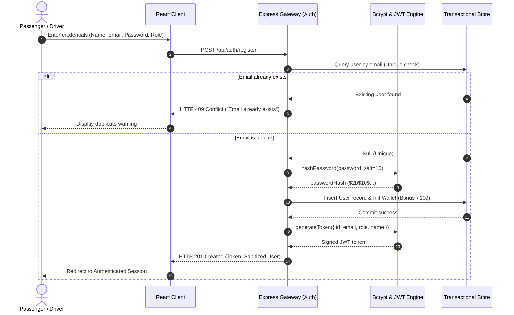

---

## 2. Passenger Ride Request Workflow

### Mermaid
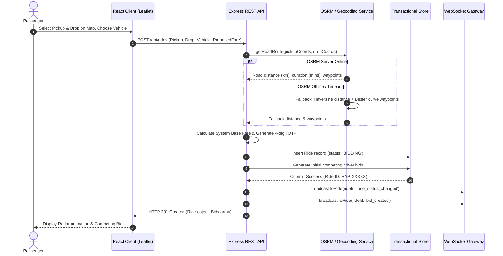

---

## 3. Driver Discovery and Ride Response Workflow

### Mermaid
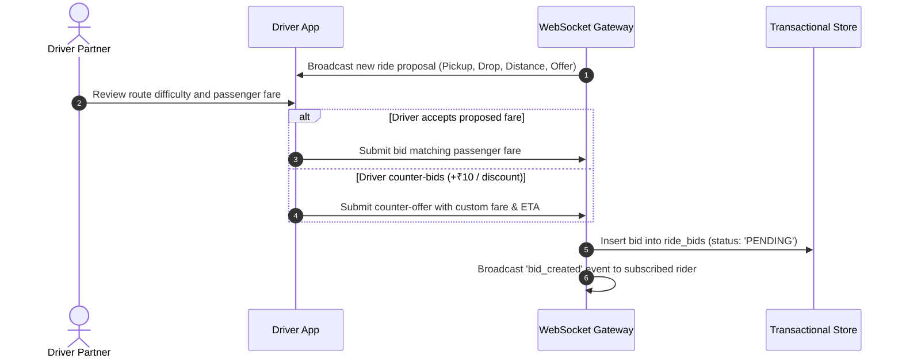

---

## 4. Fare Negotiation Workflow

### Mermaid
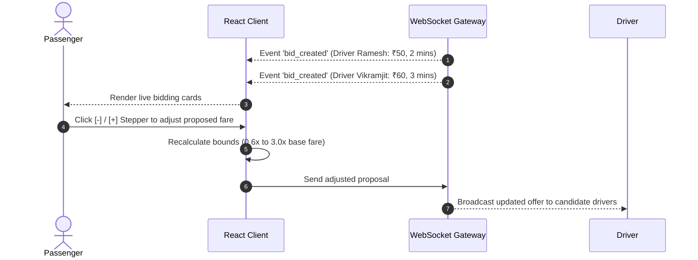

---

## 5. Fare Acceptance and Driver Assignment Workflow

### Mermaid
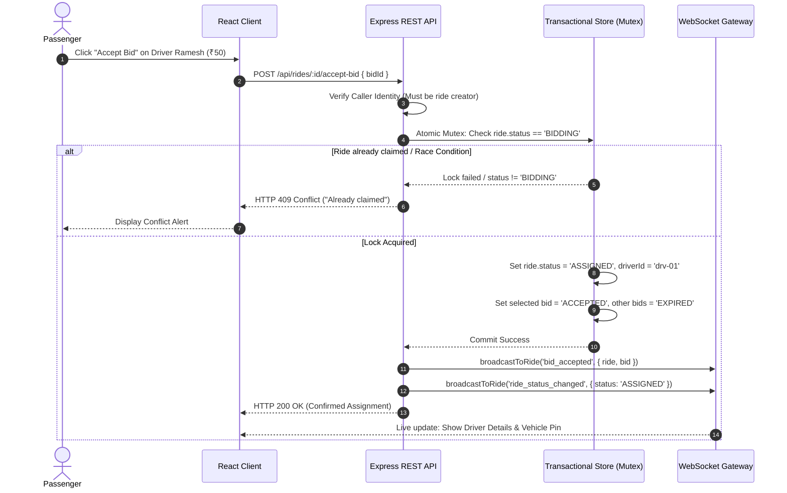

---

## 6. Ride Start and OTP Verification Workflow

### Mermaid
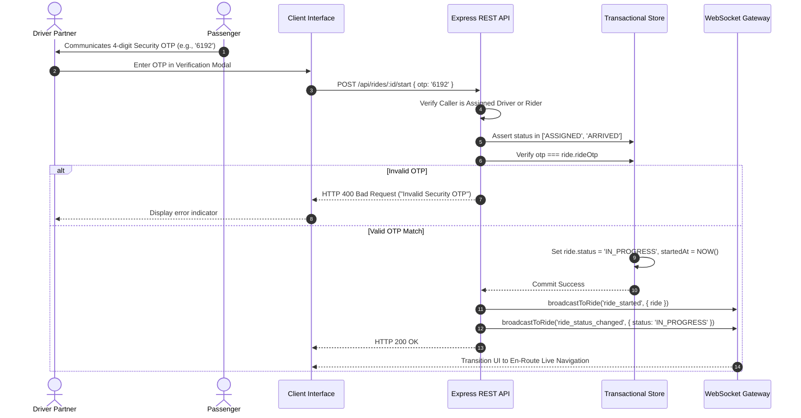

---

## 7. Live GPS Tracking Workflow

### Mermaid
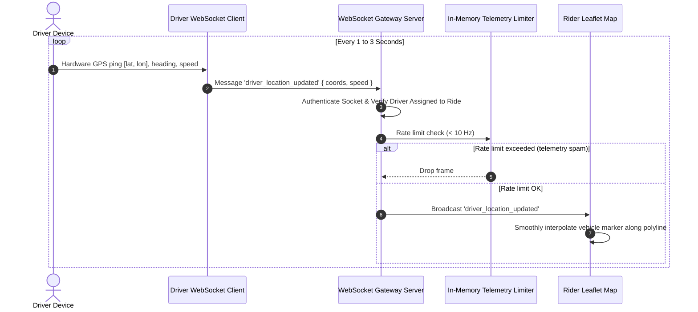

---

## 8. Ride Completion and Financial Settlement Workflow

### Mermaid
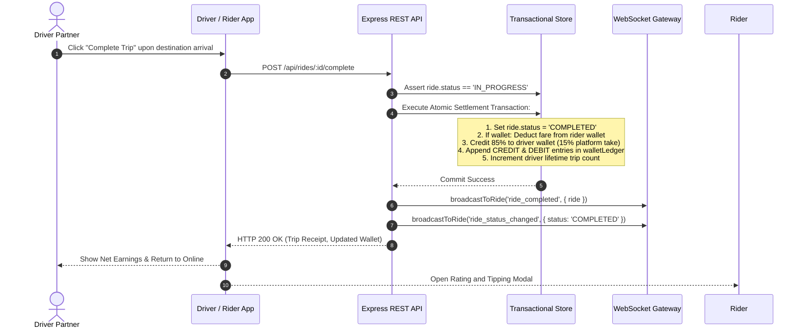

---

## 9. Driver Rating and Tipping Workflow

### Mermaid
```mermaid
sequenceDiagram
    autonumber
    actor Rider as Passenger
    participant Frontend as React Client
    participant Gateway as Express REST API
    participant Database as Transactional Store

    Rider->>Frontend: Select 5 Stars, Feedback Tags, Enter ₹20 Tip
    Frontend->>Gateway: POST /api/rides/:id/rate { rating: 5, tipAmount: 20 }
    Gateway->>Gateway: Verify Caller is Ride Owner & ride.status == 'COMPLETED'
    Gateway->>Database: Check rider wallet balance >= ₹20
    Gateway->>Database: Deduct ₹20 from rider wallet; Credit ₹20 to driver wallet
    Gateway->>Database: Record dual tip transactions in walletLedger
    Gateway->>Database: Store rating and feedback tags on ride
    Database-->>Gateway: Commit Success
    Gateway-->>Frontend: HTTP 200 OK
    Frontend-->>Rider: Display Thank You & Trip Summary
```

---

## 10. Intercity Carpool Publishing Workflow

### Mermaid
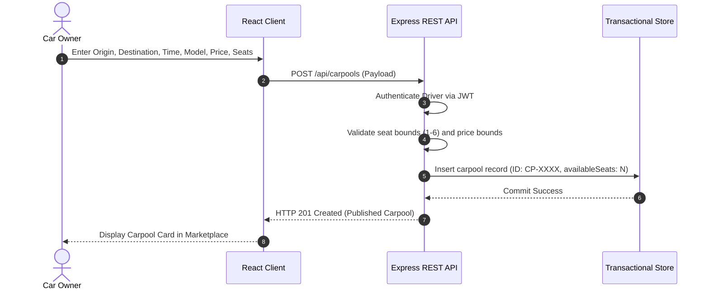

---

## 11. Carpool Search Workflow

### Mermaid
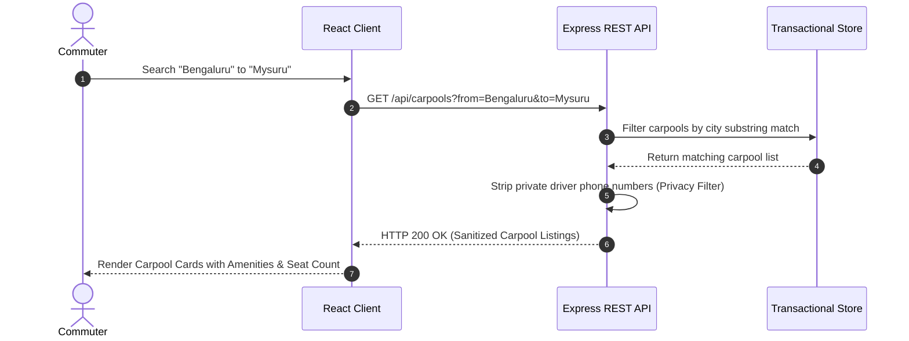

---

## 12. Seat Reservation and Balance Debit Workflow

### Mermaid
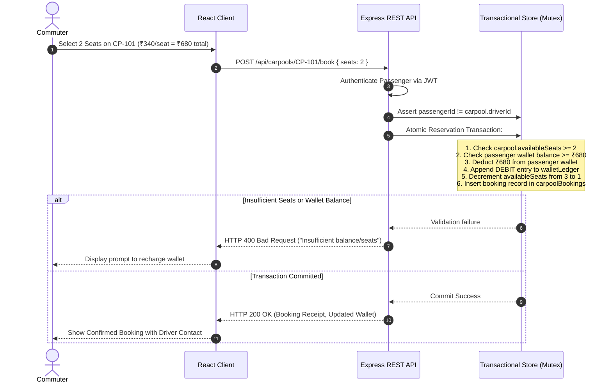
